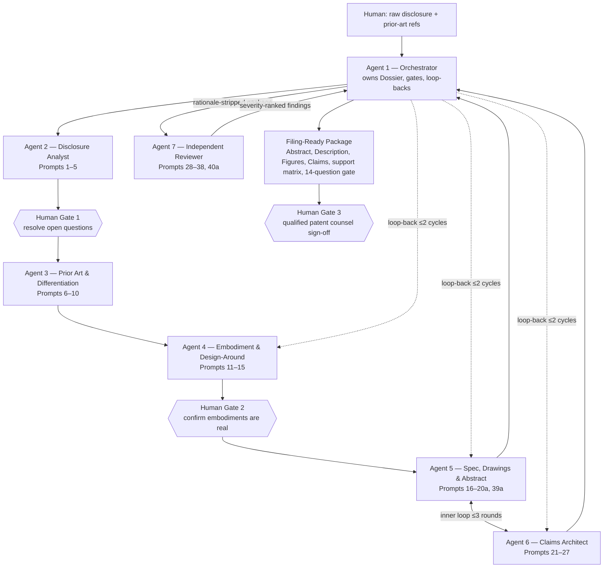

# PATENT DRAFTING PROMPT PLAYBOOK

## How to use this playbook

- Run the prompts in order rather than asking an AI to "write me a patent" in one pass.
- Keep a single Invention & Drafting Dossier containing the inventor disclosure, drawings, experimental data, search results and every drafting iteration.
- The dossier is versioned, not overwritten: every phase appends its outputs with a date/version tag, and later prompts read from it rather than from re-pasted text. **[NEW]**
- The terminology table produced in Prompt 4 is locked: every later drafting prompt must reuse it verbatim, or explicitly log a deliberate new synonym. **[NEW]**
- At each stage require the model to identify assumptions, missing support and unresolved questions rather than silently filling gaps.
- Do not add technical matter that the inventors have not actually conceived. Verify every generated embodiment with the inventors before filing.
- Before filing, run the final support matrix and adversarial review prompts against the exact specification and exact claims intended for filing.
- Treat inventor disclosure content as confidential throughout; do not pass it to external tools or services the user has not explicitly approved. Cap adversarial loop-backs at two cycles before forcing a human decision (see Phase 7). **[NEW]**

## Purpose

Use the prompts sequentially. The objective is not merely to generate claims, but to create disclosure support for broad claims, narrower fallbacks, design-arounds, future amendments, continuations/divisionals, and commercially important embodiments.

**Important:** AI drafting is a drafting and analysis aid, not a substitute for jurisdiction-specific advice from a qualified patent attorney or patent agent. Novelty, inventive step/non-obviousness, added matter, enablement, unity and claim-format rules vary by jurisdiction.

## Reusable instruction header

> Act as a senior patent drafting team combining the perspectives of a patent attorney, patent examiner, technical specialist, competitor seeking to design around the patent, and future litigator. Be precise. Do not invent technical facts. Clearly label assumptions and missing information. Preserve broad disclosure while providing concrete implementations and fallback positions. For every proposed claim limitation, identify where it is supported in the specification. Distinguish what appears essential from what is merely optional or preferred. *Read from, and write outputs back into, the shared Invention & Drafting Dossier rather than relying on text re-pasted into the conversation. Treat all inventor disclosure content as confidential: do not transmit it to external tools or services beyond those the user has explicitly approved, and flag any personal data unrelated to the invention.*

Additions shown in italics above are new in this revision (R1, R6).

---

## PHASE 1 — INVENTION CAPTURE & COMMERCIAL SCOPE

### 1. Invention extraction

Convert the inventor's raw concept into a structured invention disclosure.

> Review the following invention disclosure: [INSERT]. Extract: (a) problem being solved; (b) core inventive concept; (c) technical effect; (d) essential components/steps; (e) optional components; (f) alternative implementations; (g) inputs/outputs; (h) materials, dimensions, ranges and operating conditions; (i) control logic/software; (j) manufacturing methods; (k) use cases; (l) experimental evidence; and (m) unresolved technical questions. Do not draft claims yet.

### 2. Commercial value map

Make claim strategy follow the product and licensing opportunity.

> For this invention, identify the commercially valuable architectures, components, consumables, methods of manufacture, methods of use, software/control functions, systems and interfaces that competitors would need to practise. Rank them by commercial importance and explain which should be protected by independent claims versus dependent claims or separate claim families.

### 3. Inventive nucleus

Separate the true inventive concept from implementation detail.

> Identify the minimum technical combination that appears to create the new technical effect. Then produce progressively narrower versions adding implementation features. For each feature state whether it is potentially essential, advantageous, conventional, or merely exemplary. Flag any feature whose omission may undermine enablement or technical effect.

### 4. Terminology and ontology

Prevent accidental narrowing and inconsistent language.

> Create a terminology table for the invention. For every important component or action provide: preferred neutral term, possible synonyms, broader genus terms, narrower species terms, functional descriptions and terms to avoid because they may unnecessarily narrow scope. Identify terms that require an express definition in the specification. This table becomes the locked terminology reference for every later drafting prompt (see R2).

### 5. Inventor interrogation

Expose missing disclosure before drafting.

> Generate a rigorous inventor interview questionnaire designed to uncover embodiments, alternatives, edge cases, parameter ranges, materials, geometries, sequences, failure modes, manufacturing options, control approaches and unexpected advantages not yet stated. Prioritise questions whose answers could materially broaden claim scope or provide fallback positions.

---

## PHASE 2 — PRIOR ART, NOVELTY & DIFFERENTIATION

### 6. Search concept decomposition

Create a search strategy before relying on known references.

> Break the invention into searchable technical concepts and combinations. Generate keyword families, synonyms, CPC/IPC themes, applicant/assignee categories and search strings. Separate searches for the core architecture, individual components, functional equivalents, manufacturing method, use method and adjacent technologies.

### 7. Prior-art claim chart

Map what is actually disclosed rather than relying on abstracts.

> For each supplied prior-art reference [INSERT REFERENCES], create an element-by-element chart against the proposed inventive concepts. Distinguish explicit disclosure, implicit/inherent disclosure, absent features and ambiguous features. Quote or cite the precise passages/figures where available. Do not combine references when assessing strict novelty; separately analyse combinations for inventive step/non-obviousness.

### 8. Novelty and inventive-step attack (preliminary)

Think like a hostile examiner — early, to shape strategy, not as the final gate.

> Act as a highly sceptical patent examiner. Construct the strongest novelty and inventive-step/non-obviousness objections against each proposed independent claim concept using the identified prior art. Explain likely motivation-to-combine arguments, routine optimisation arguments, obvious alternatives and common-general-knowledge attacks. This is a diagnostic pass to inform differentiation and claim strategy; the comprehensive, final-text version of this exercise runs independently in Prompt 32.

### 9. Differentiation matrix

Find defensible technical distinctions.

> Create a matrix: prior-art feature → our differentiating feature → technical effect → evidence/support → possible claim language → design-around risk. Prefer structural or process relationships that produce a technical effect over result-only language.

### 10. White-space analysis

Find protectable territory beyond the first concept.

> Based on the invention and prior art, identify technical white space that is genuinely supported by the inventor's disclosure. Look for novel sub-combinations, interfaces, sequencing, geometries, control schemes, manufacturing steps, calibration methods, disposable/reusable divisions and use protocols. Do not invent unsupported subject matter.

---

## PHASE 3 — DESIGN-AROUND & EMBODIMENT EXPANSION

### 11. Competitor design-around attack

Draft against foreseeable evasions.

> Assume you are a well-funded competitor who has read our proposed patent and wants the same commercial outcome without infringement. Generate at least 15 technically realistic design-arounds. For each, state which proposed claim limitation is avoided and how the specification could legitimately describe a broader genus or alternative embodiment to reduce that escape route.

### 12. Equivalent architectures

Broaden the disclosure without relying on vague boilerplate.

> For every essential-looking component or step, identify functionally equivalent architectures that could achieve the same technical purpose. Describe concrete alternative structures, materials, mechanisms, ordering, coupling, actuation, sensing, processing and manufacturing approaches. Only include technically credible alternatives.

### 13. Parameter/range ladder

Create quantitative fallback positions.

> Identify every parameter that could matter: dimensions, concentration, temperature, pressure, time, force, frequency, dose, ratio, spacing, tolerances, thresholds and performance values. For each, propose a disclosure ladder containing broad range, intermediate ranges, narrower preferred ranges, endpoints and representative values, but only where scientifically supportable. Flag ranges requiring inventor confirmation or data.

### 14. Combination/permutation map

Support future claim combinations.

> Create a feature-combination matrix showing which optional features can be combined with each core embodiment. Identify combinations likely to be commercially important or patentably distinct. Draft specification language that expressly supports these combinations without asserting technically incompatible permutations.

### 15. Failure-mode embodiments

Protect improvements that solve practical problems.

> List foreseeable failure modes, abuse cases, manufacturing variability, environmental conditions and user errors. For each, identify technical mitigations and whether those mitigations should be disclosed as alternative embodiments or dependent-claim fallbacks.

---

## PHASE 4 — SPECIFICATION ARCHITECTURE & ENABLEMENT

### 16. Specification blueprint

Build the disclosure before polishing prose.

> Create a complete patent specification outline comprising title, technical field, background, problem, summary, brief description of drawings, detailed description, definitions, embodiments, examples, manufacturing/assembly, operation/use, alternatives, ranges, data/results and claim-support sections. Map every proposed claim family to the sections needed to support it.

### 17. Enablement/sufficiency audit

Check whether the skilled person can actually practise the scope.

> Audit the disclosure for enablement/sufficiency across the full intended claim breadth. Identify embodiments that would require undue experimentation, missing materials/process conditions, unsupported functional breadth, unpredictable technical areas, absent examples and parameters that need explanation. Recommend additional disclosure or experiments before filing.

### 18. Best implementation/examples

Capture concrete working embodiments.

> For each principal embodiment, draft a technically detailed worked implementation including components, materials, dimensions/ranges, fabrication/assembly, operating sequence, inputs/outputs and expected technical effect. Separate actual experimental examples from prophetic examples and do not fabricate results.

### 19. Definitions and broad language

Create deliberate breadth, not ambiguity.

> Draft definitions for key terms that clarify scope while remaining technically credible. Identify where "comprising", optionality, singular/plural usage, direct/indirect coupling, ranges, approximately/about, order of steps and functional terminology need explicit treatment. Avoid definitions that contradict ordinary technical meaning or the embodiments.

### 20. Drawings plan

Make figures carry disclosure value.

> Generate a figure plan that maximises technical disclosure: system overview, exploded views, cross-sections, process flow, alternative architectures, control logic, manufacturing sequence and use sequence. For each figure list reference numerals and the specific claim concepts/fallbacks it supports.

### 20a. Reference-numeral registry & drawing generation **[NEW]**

Turn the figure plan into consistent, generated figures — not just a plan.

> Using the figure plan from Prompt 20, generate the actual figures (or generation-ready drawing instructions for a draftsperson/CAD tool) for each planned view. Maintain a single reference-numeral registry mapping every numeral to a component name, the figure in which it is first introduced, and every figure in which it subsequently appears. Flag any numeral used inconsistently, any component named in the description or claims that lacks a numeral, and any figure that omits a numeral its description text relies on. This registry is cross-checked again in Prompt 38.

---

## PHASE 5 — CLAIM ARCHITECTURE

### 21. Claim-family strategy

Protect the invention from multiple infringement angles.

> Propose a claim-family architecture covering, where appropriate: apparatus/device, system, method of operation/use, method of manufacture, composition/material, kit, consumable, controller/software/computer-implemented method, data-processing method and product-by-process. State which families are justified by the disclosure and commercial model; do not add claim categories merely for volume.

### 22. Broad independent claims

Draft the commercial perimeter.

> Draft alternative independent claims directed to the core commercial architectures. Use the fewest limitations reasonably necessary to distinguish the known art while maintaining clarity, support and enablement. For each limitation provide: reason included, specification support, likely prior-art vulnerability and likely design-around route.

### 23. Dependent-claim ladder

Build fallback positions deliberately.

> For each independent claim create a dependent-claim ladder from broad to narrow. Cover structural relationships, materials, geometry, ranges, operating modes, control logic, manufacturing features and use conditions. Each dependent claim should add a meaningful fallback rather than cosmetic detail. Identify the technical effect associated with each added limitation.

### 24. Multiple independent formulations

Avoid betting the patent on one wording.

> Draft 3 materially different independent-claim approaches to the same inventive concept: (1) structural architecture, (2) functional/relationship-based architecture, and (3) process or interaction architecture where support permits. Compare breadth, clarity, prior-art exposure, enablement risk and design-around resistance.

### 25. Claim differentiation and dependency audit

Remove redundancy and dependency errors.

> Audit the full claim set for antecedent basis, dependency, internal consistency, duplicate scope, accidental exclusion, unnecessary limitations, unclear relative terms, unsupported terminology, mixed statutory categories and contradictions. Recommend a clean dependency tree.

### 26. Means/functional language audit

Control interpretation risk.

> Identify every functional or result-oriented limitation. Assess whether it is adequately supported by disclosed structures/algorithms and whether jurisdiction-specific interpretation could narrow it. Where appropriate, propose structural alternatives and ensure the description discloses multiple ways of performing the claimed function.

### 27. Omnibus fallback claim concepts

Capture sub-combinations worth preserving.

> Identify independently valuable sub-combinations disclosed in the specification that could support later amendment, continuation/divisional practice or separate inventions. Draft candidate claim concepts and identify exact supporting passages/figures needed in the initial filing.

---

## PHASE 6 — SUPPORT, ADDED-MATTER & JURISDICTIONAL RESILIENCE

### 28. Claim-to-specification support matrix

Make every limitation traceable.

> For every limitation of every claim, create a support matrix identifying exact paragraph/section/figure support, whether support is explicit or implicit, and whether the limitation is disclosed in the claimed combination. Flag any claim language that lacks direct and unambiguous support or may create written-description/added-matter risk.

### 29. Amendment basis stress test

Prepare for prosecution before filing.

> Assume the broad independent claims are rejected. Generate 10 plausible amendment paths using only features expressly disclosed in the application as filed. For each path identify the exact combination support and explain whether intermediate generalisation or added-matter concerns could arise. Recommend specification additions before filing to strengthen amendment basis.

### 30. US/EPO/UK resilience review

Expose jurisdiction-specific drafting weaknesses.

> Review the draft for major US, EPO and UK prosecution risks, including written description/support, enablement/sufficiency, clarity/definiteness, added matter, unity, excluded subject matter/patent eligibility, functional claiming, multiple dependencies and claim fees/format considerations. Do not give a definitive legal conclusion; identify issues for counsel review.

### 31. Priority entitlement/new matter control

Protect the priority chain.

> Compare the intended claims against the earliest priority disclosure. Identify every limitation or combination that may not be supported in the priority document and therefore may lose priority. Separate genuinely new matter that should only receive the later filing date. Produce a priority-support matrix.

---

## PHASE 7 — ADVERSARIAL FINAL REVIEW

### 32. Examiner red-team (final)

Try to reject the application, against the exact filing text.

> Review the complete specification and claims as a hostile examiner. Identify the 20 strongest objections or weaknesses, ranked critical/high/medium/low, covering novelty, inventive step/non-obviousness, clarity, support, enablement, unity, eligibility, claim construction and formal inconsistencies. For each, propose the least narrowing corrective action. Run this prompt in the independent-reviewer context (Agent 7 / R8): supply only the finished specification and claims, not the drafting rationale.

### 33. Litigation/enforcement red-team

Ask whether the claims will matter after grant.

> Assume the patent is granted and a major competitor launches a close product. Analyse which claim elements will be easiest to avoid, hardest to prove, hidden inside a process, dependent on intent, or difficult to detect from a commercial product. Recommend claim formulations that improve detectability and enforceability while remaining supported.

### 34. Freedom-to-operate separation

Avoid confusing patentability with freedom to operate.

> Separately identify third-party patents that could potentially be practised by our contemplated product even if our invention is patentable. Explain that patentability does not establish freedom to operate. Produce an FTO issue list for professional claim-chart review, focusing on live claims and relevant jurisdictions.

### 35. Commercial moat score

Prioritise claims that competitors cannot economically avoid.

> Score each independent claim concept from 1-10 for: commercial relevance, breadth, novelty resilience, inventive-step resilience, design-around resistance, infringement detectability, evidentiary ease and support strength. Identify which claims actually protect the commercially successful architecture and which are merely technically interesting.

### 36. Final filing gap analysis

Last pre-filing completeness check.

> Perform a final gap analysis of the exact filing package. Ask: What would we regret not disclosing if a competitor exploited it 18 months from now? Identify missing embodiments, definitions, combinations, ranges, drawings, examples, manufacturing alternatives, control logic, use cases, claim families and fallback positions that are already within the inventors' conception and should be added before filing.

### Loop-back & iteration rules **[NEW]**

Phase 7 findings do not stop at a report — each finding category re-enters a specific earlier phase. The Orchestrator (Part C, Agent 1) applies this table and caps re-entry at two full loop-back cycles per finding category before forcing a human decision rather than further automated iteration:

| Finding category | Source prompts | Re-enters |
|---|---|---|
| Novelty / inventive-step objection | 32 | Phase 3 (additional embodiments/design-arounds) and Phase 5 (claim reformulation) |
| Enablement or written-description gap | 17, 32 | Phase 4 (specification) before touching claims |
| Design-around / detectability weakness | 11, 33, 35 | Phase 3 (embodiments) and Phase 5 (claims) together, since a design-around fix usually needs both new disclosure and new claim language |
| Support-matrix or priority gap | 28, 29, 31 | Phase 4 only — add disclosure, do not narrow claims to fit; narrowing is a last resort noted for human review |
| Formal/consistency findings | 37, 38, 40a | Corrected in place by the same phase; these never require a full loop-back |

---

## PHASE 8 — FINAL CLAIM & FILING QA

### 37. Claims-only forensic audit

Check the exact final claim text.

> For the final claims below [INSERT], perform a line-by-line forensic audit for antecedent basis, grammar, numbering, dependency, multiple dependency, claim category, consistency of terminology, optional language, relative terms, functional language, unnecessary limitations, unsupported terms and possible interpretation traps. Return a corrected claim set plus a change log.

### 38. Specification consistency audit

Eliminate internal contradictions.

> Search the final specification for inconsistent terminology, conflicting ranges, inconsistent reference numerals, mandatory language that conflicts with broader claims, statements that disparage or exclude viable embodiments, accidental admissions about prior art, and summary language narrower than the claims. List exact corrections. Cross-check against the locked terminology table (Prompt 4 / R2) and the reference-numeral registry (Prompt 20a / R4); report any drift from either as a corrected item, not a new finding.

### 39. Filing checklist

Create a final human sign-off.

> Generate a pre-filing checklist covering inventorship confirmation, applicant/ownership, priority details, drawings, sequence listings if applicable, examples/data labelling, claim count/dependencies, abstract, title, reference numerals, support matrix, prior-art disclosures/IDS considerations, assignment/confidentiality issues and jurisdiction-specific formalities for counsel to confirm.

### 39a. Abstract drafting **[NEW]**

Draft the required, format-constrained summary — last, and only from finished text.

> Using only the finalized detailed description and finalized claims (not the drafting history or earlier phase outputs), draft the Abstract: a single paragraph, approximately 50–150 words depending on jurisdiction, stating the technical field and the core technical solution in plain, non-legal language. Do not introduce new technical matter, do not use "means for" or other claim-style language, and do not include marketing or legal-conclusion language. Flag if the finalized claims changed after this draft was produced, since the abstract would then need to be re-checked.

### 40a. Formal / mechanical compliance pass **[NEW]**

Check filing mechanics separately from filing substance.

> Review the finished package against the target jurisdiction's formal requirements: paragraph numbering (e.g. USPTO [0001]-style), claim numbering and format, two-part claim form (preamble / characterising portion) where applicable, reference-sign conventions in claims, drawing sheet/margin/numbering rules, and any sequence-listing or similar formal annex requirements. List corrections as formal-only; do not re-raise substantive issues already captured in Prompt 30.

### 40. Future prosecution map

Preserve strategic optionality.

> Based solely on subject matter disclosed in this application, create a prosecution roadmap identifying the primary claim set, likely fallback amendments, possible continuation/divisional claim themes, inventions that may trigger lack-of-unity/restriction, and commercially important subject matter that should not be inadvertently abandoned. Do not assume later-added subject matter can obtain the original filing date.

---

## Master prompts for complete reviews

### A. Master drafting prompt

> Using the inventor disclosure, verified prior art and technical data supplied, prepare a patent drafting package. First identify missing information; then create the invention map, terminology map, commercial-protection map, embodiment tree, design-around analysis, specification outline, detailed disclosure, figure plan, claim-family strategy, independent claims, dependent fallback ladder and claim-to-support matrix. Do not fabricate facts, prior art, data or experimental results. Maintain a distinction between essential and optional features. Ensure the description expressly supports foreseeable combinations and alternative implementations. After drafting, red-team the application for novelty, inventive step/non-obviousness, clarity, enablement/sufficiency, written description/support, added matter, unity, eligibility and design-around risk. Finish with a list of questions that must be resolved before filing.

### B. Master "watertightness" stress-test prompt

> Assume this application will become commercially important and will be attacked by an examiner, an opposition team, a competitor designing around it and litigation counsel. Review the exact specification and claims. Identify every plausible weakness in priority support, novelty, inventive step/non-obviousness, enablement, written description, clarity, claim construction, essentiality, functional language, ranges, combinations, infringement detectability and design-around resistance. For each weakness: quote the relevant claim language; identify specification support; explain the attack; assign severity; and propose the least narrowing correction. Then identify any disclosure that should be added before filing because it is already part of the inventors' conception but is not yet adequately expressed.

### C. Master claim-refinement prompt

> Take the role of both prosecution counsel and a competitor. Starting from these claims, iteratively refine them to maximise commercially meaningful scope while retaining support and a credible distinction over the verified prior art. Do not solve prior-art problems by reflexively adding narrow details. First test whether a broader relationship, architecture, sequence or technical effect is supportable. Maintain at least one meaningful fallback ladder. For every revision, provide: old wording, new wording, reason, scope impact, prior-art impact, design-around impact and exact specification support.

---

## The 14-question filing gate

(Expanded from the original 12 — two new questions, marked [NEW], cover the Abstract and formal-compliance additions.)

- [ ] Do the independent claims cover the product or architecture that would actually make money?
- [ ] Can a competitor obtain substantially the same technical/commercial result while omitting one claim element?
- [ ] Are the likely design-arounds expressly disclosed as alternatives where genuinely conceived?
- [ ] Does every claim limitation have clear support in the application as filed, including the claimed combination?
- [ ] Are there enough narrower fallback positions to survive the most credible prior art?
- [ ] Does the disclosure enable the intended breadth without undue experimentation?
- [ ] Have quantitative ranges, endpoints, intermediate ranges and representative values been captured where relevant?
- [ ] Are manufacturing, use, system, device, consumable and software/control aspects protected where commercially justified?
- [ ] Will infringement of the key claims be detectable from the competitor's product, documentation or process?
- [ ] Have priority support and potential later-added subject matter been separated?
- [ ] Have potential continuation/divisional themes been disclosed sufficiently in the first filing?
- [ ] Does the Abstract accurately summarise the finalized claims with no new technical matter, legal phrases or "means for" language? **[NEW]**
- [ ] Has the formal/mechanical compliance pass (paragraph numbering, claim format, reference signs, drawing rules) been completed for the target jurisdiction(s)? **[NEW]**
- [ ] Has qualified patent counsel reviewed jurisdiction-specific legal and formal requirements before filing?

## Practical drafting principle

The strongest initial filing is usually not the one with the greatest number of claims. It is the one whose description contains a deliberate hierarchy of broad concepts, concrete embodiments, technically credible alternatives, explicit combinations and quantitative fallbacks, allowing claims to be prosecuted and reshaped later without adding new matter. Claims define the requested monopoly; the specification is the reservoir from which future claim scope and amendments must be supported.

---

# Part C — The Seven-Agent Drafting Architecture

The revised playbook above is written to be executed, not only read. This section defines seven agents that together run it end to end — from raw inventor disclosure to a filing-ready package containing the Abstract, Description, all Figures, and Claims — with the state model, terminology lock, loop-backs and independent-review separation from Part B built into how they hand work to one another.

## Design principles carried over from the critique

- One shared, versioned Dossier (R1) is the single source of truth every agent reads from and writes to — no agent re-derives facts from a re-pasted summary.
- Generators are separated from the critic (R8): Agents 2–6 draft; Agent 7 reviews independently, blind to their reasoning, seeing only finished text.
- Nothing is treated as fact until a human confirms it. Agent outputs about the invention itself are always "candidate" until the relevant human gate accepts them — this mirrors the original instruction that no AI-generated embodiment ships unverified.
- Three human gates are mandatory, not optional: they are not a suggestion an agent can route around under time pressure, and no agent may authorize filing.

## Orchestration diagram

## Agent profiles

### AGENT 1 — Orchestrator (Lead Drafting Coordinator)

Owns the Dossier, sequences the other six agents through the eight phases, enforces the terminology lock, manages the three human gates, applies the loop-back rules after Agent 7's review, and assembles the final filing package. It is a router and state manager, not a subject-matter drafter.

**Maps to playbook prompts:**
- All — owns process, not content. Applies the reusable instruction header and R1/R2/R5/R6 to every downstream call.

**Inputs:**
- Raw inventor disclosure (text, drawings, data)
- User-supplied prior-art references
- Human decisions at each gate

**Core responsibilities:**
- Open and version the Dossier; attach it (not raw chat history) to every agent invocation.
- Sequence Agents 2→3→4, then the Agent 5↔6 inner loop, then Agent 7.
- Enforce the terminology lock: reject any drafting output from Agents 4–6 that introduces an undefined synonym without a logged reason.
- After Agent 7 reports, classify each finding against the loop-back table (Part B) and re-invoke only the specific agent(s) required, capped at two cycles per finding category.
- Compile the final package: Abstract, Description, Figures, Claims, support matrix, 14-question gate results.

**Outputs (written to the Dossier):**
- Dossier version history
- Phase-gate summaries for human review
- Final filing package

**Guardrails:**
- Never fills a factual gap itself — an unresolved Open Question blocks only the downstream phases that depend on it, and is surfaced to the human, not silently resolved.
- Never authorizes filing; Human Gate 3 is mandatory regardless of how clean Agent 7's report is.

**Interaction contract:**
- Upstream: human only.
- Downstream: invokes Agents 2–7 in the sequence in the diagram; receives every agent's output before deciding the next call.
- Loop-back entry point: the only agent Agent 7 reports to; the only agent that re-invokes Agents 4/5/6 after a finding.

### AGENT 2 — Disclosure Analyst

Converts the inventor's raw input into the structured disclosure the rest of the system runs on, and produces the terminology table that becomes the locked reference for every later drafting step.

**Maps to playbook prompts:**
- Prompts 1–5 (Phase 1)

**Inputs:**
- Raw inventor disclosure
- Any existing drawings/data supplied with it

**Core responsibilities:**
- Invention extraction (Prompt 1): problem, inventive concept, technical effect, essential/optional components, alternatives, inputs/outputs, materials/ranges, control logic, manufacturing, use cases, experimental evidence, open questions.
- Commercial value map (Prompt 2) ranking what needs protecting and by which claim type.
- Inventive nucleus (Prompt 3): minimum combination that creates the technical effect, with essential/advantageous/conventional/exemplary tags.
- Terminology & ontology table (Prompt 4) — becomes locked (R2).
- Inventor interrogation questionnaire (Prompt 5) for anything material still missing.

**Outputs (written to the Dossier):**
- Structured Invention Disclosure
- Commercial Value Map
- Inventive Nucleus statement
- Locked Terminology Table
- Open Questions list

**Guardrails:**
- Never fills a gap with an invented technical fact — every unanswered item goes to Open Questions, which blocks any downstream phase that depends on it until Human Gate 1 resolves it.

**Interaction contract:**
- Receives from: Orchestrator (raw disclosure).
- Sends to: Orchestrator, which routes the Terminology Table to every other agent as a locked reference, and the Commercial Value Map + Inventive Nucleus to Agents 4 and 6.
- Triggers: Human Gate 1 (inventor resolves open questions) before Agent 3 proceeds on anything those questions affect.

### AGENT 3 — Prior Art & Differentiation Strategist

Builds the evidentiary picture of the prior-art landscape strictly from references the human supplies, and turns it into defensible technical differentiation and white-space opportunities.

**Maps to playbook prompts:**
- Prompts 6–10 (Phase 2)

**Inputs:**
- Structured Invention Disclosure + Terminology Table (Agent 2)
- User-supplied prior-art references

**Core responsibilities:**
- Search-concept decomposition (Prompt 6) into keyword families, CPC/IPC themes and search strings, to guide the human's or a search tool's reference gathering.
- Element-by-element prior-art claim charts (Prompt 7) against every supplied reference.
- Preliminary novelty/inventive-step attack (Prompt 8) to pressure-test the concept early.
- Differentiation matrix (Prompt 9) and white-space analysis (Prompt 10).

**Outputs (written to the Dossier):**
- Prior-Art Claim Charts
- Preliminary Novelty Attack memo
- Differentiation Matrix
- White-Space Opportunity list

**Guardrails:**
- Analyses only references the human/attorney actually supplied — never cites or relies on a reference from its own memory, and flags when search coverage looks thin enough to warrant a professional search before proceeding.
- Quotes or cites the precise passage for every disclosure claim, per Prompt 7.

**Interaction contract:**
- Receives from: Agent 2 via Orchestrator.
- Sends to: Agent 4 (Differentiation Matrix + White Space feed the design-around and embodiment expansion), and Agent 6 (claim charts inform claim-family strategy).

### AGENT 4 — Embodiment & Design-Around Architect

Expands the confirmed inventive nucleus into the full embodiment set the specification will need — equivalents, ranges, combinations, failure-mode fixes — and stress-tests it against a well-resourced competitor before any of it is written up as prose.

**Maps to playbook prompts:**
- Prompts 11–15 (Phase 3)

**Inputs:**
- Inventive Nucleus + essential/optional split (Agent 2)
- Differentiation Matrix + White Space (Agent 3)

**Core responsibilities:**
- Competitor design-around attack (Prompt 11): 15+ realistic design-arounds, each mapped to the limitation it avoids.
- Equivalent architectures (Prompt 12) for every essential-looking component.
- Parameter/range ladders (Prompt 13), flagged for inventor confirmation where not data-backed.
- Combination/permutation map (Prompt 14) of which optional features combine with which core embodiments.
- Failure-mode embodiments (Prompt 15) and their disclosed mitigations.

**Outputs (written to the Dossier):**
- Design-Around Risk Register
- Equivalent Architecture Library
- Parameter Ladders
- Combination Matrix
- Failure-Mode Embodiment set — all appended to the Dossier as candidate embodiments

**Guardrails:**
- Every output here is explicitly marked candidate, not confirmed — it does not become specification content until Human Gate 2 verifies the embodiments are technically real, per the playbook's core instruction not to add matter the inventors haven't conceived.
- Only technically credible alternatives; ranges without supporting data are flagged, not asserted.

**Interaction contract:**
- Receives from: Agents 2 and 3 via Orchestrator.
- Sends to: Human Gate 2, then Agent 5 (confirmed embodiments only).
- Loop-back target: re-invoked by the Orchestrator after Agent 7 findings on novelty, design-around risk, or detectability.

### AGENT 5 — Specification, Drawings & Abstract Drafter

The largest single content producer: turns the confirmed dossier into the actual Description, generates all Figures with a consistent reference-numeral registry, and — last, once everything else is final — drafts the Abstract.

**Maps to playbook prompts:**
- Prompts 16–20, 20a (Phase 4); Prompt 39a (Abstract, run late — see below)

**Inputs:**
- Confirmed embodiments (post Human Gate 2)
- Locked Terminology Table
- Claim drafts from Agent 6 (inner loop, see below)

**Core responsibilities:**
- Specification blueprint (Prompt 16) mapping every claim family to the sections that support it.
- Enablement/sufficiency audit (Prompt 17) run before finalizing breadth — narrows the described scope or flags a data gap rather than shipping an unenabled embodiment.
- Worked embodiments/examples (Prompt 18), strictly separating actual experimental results from prophetic examples.
- Definitions and broad-language treatment (Prompt 19), consistent with the locked terminology.
- Figure plan, figure generation, and reference-numeral registry (Prompt 20 + 20a).
- Abstract (Prompt 39a) — drafted only once the Description and Claims are both finalized and have passed Agent 7's review, from that finished text, never independently.

**Outputs (written to the Dossier):**
- Full Description (spec blueprint through definitions)
- All Figures + Reference-Numeral Registry
- Abstract (drafted late, appended after Agent 7 sign-off on substance)

**Guardrails:**
- Never fabricates experimental data or results — prophetic examples are explicitly labelled as such.
- The enablement audit is a gate on its own output: breadth it cannot enable does not go out described as enabled.

**Interaction contract:**
- Receives from: Agent 4 (confirmed embodiments), Agent 6 (claim language, in a tight two-way loop).
- Sends to: Agent 6 (finished spec + numeral registry, so claim language matches described structures precisely) and Orchestrator (Description + Figures for the Phase 4 gate; Abstract at the very end).
- Inner loop: Agents 5 and 6 iterate directly with each other — not strict waterfall — capped by the Orchestrator at roughly three rounds before moving to Agent 7 regardless of full convergence, with any open disagreement flagged.

### AGENT 6 — Claims Architect

Builds the claim-family strategy and drafts every claim, checking as it goes that each limitation traces to something Agent 5 actually described — and pushing back to Agent 5 for more disclosure rather than drafting an unsupported claim.

**Maps to playbook prompts:**
- Prompts 21–27 (Phase 5)

**Inputs:**
- Full Description + numeral registry (Agent 5)
- Differentiation Matrix (Agent 3)
- Commercial Value Map (Agent 2)

**Core responsibilities:**
- Claim-family strategy (Prompt 21): which statutory categories are justified by disclosure and commercial model.
- Broad independent claims (Prompt 22), fewest limitations reasonably necessary.
- Dependent-claim ladders (Prompt 23), each rung a meaningful fallback.
- Three materially different independent-claim formulations (Prompt 24): structural, functional/relationship, process/interaction.
- Claim differentiation and dependency audit (Prompt 25) and means/functional-language audit (Prompt 26).
- Omnibus fallback claim concepts (Prompt 27) for valuable sub-combinations.

**Outputs (written to the Dossier):**
- Claim-Family Architecture
- Draft independent claims (multiple formulations)
- Dependent-claim ladders
- Clean dependency tree
- Functional-language risk flags
- Omnibus/sub-combination candidates

**Guardrails:**
- A pre-check runs here: every claim limitation must map to an explicit passage in Agent 5's specification. If it doesn't, the limitation is not drafted as a claim — it is flagged back to Agent 5 as a disclosure request. The rigorous, final version of this check is Agent 7's support-matrix audit (Prompt 28); this is the early version that keeps the inner loop honest.

**Interaction contract:**
- Receives from: Agent 5 (spec), Agent 3 (claim charts), Agent 2 (value map), all via Orchestrator.
- Sends to: Agent 5 (disclosure requests, in the same inner loop described under Agent 5) and Orchestrator (claim set for the Phase 5 gate).
- Loop-back target: re-invoked after Agent 7 findings on novelty, design-around risk, functional-language interpretation risk, or claim-support gaps.

### AGENT 7 — Independent Reviewer — Verification, Compliance & Red-Team

Runs deliberately as a separate context from Agents 2–6: it receives only the finished Description, Figures and Claims — never the drafting chat history or rationale — specifically to avoid the anchoring bias of a drafter marking its own work (R8). This is the compliance and adversarial gate before any human sign-off.

**Maps to playbook prompts:**
- Prompts 28–31 (Phase 6); Prompts 32–36 (Phase 7); Prompts 37–38, 40a (Phase 8)

**Inputs:**
- Finished Description + Figures + Claims only — no rationale, no chat history

**Core responsibilities:**
- Claim-to-specification support matrix (Prompt 28) and amendment-basis stress test (Prompt 29).
- US/EPO/UK resilience review (Prompt 30) and priority/new-matter control (Prompt 31).
- Examiner red-team, final and comprehensive (Prompt 32) — 20 strongest objections, severity-ranked.
- Litigation/enforcement red-team (Prompt 33), FTO separation (Prompt 34), commercial moat scoring (Prompt 35), final filing gap analysis (Prompt 36).
- Claims-only forensic audit (Prompt 37) and specification consistency audit (Prompt 38), including the terminology-lock and reference-numeral-registry cross-checks (R2, R4).
- Formal/mechanical compliance pass (Prompt 40a) and the filing checklist (Prompt 39), plus the 14-question gate as a structured checklist for the human.

**Outputs (written to the Dossier):**
- Severity-ranked findings (critical/high/medium/low) with least-narrowing corrective action per finding
- Support matrix, priority-support matrix, resilience review
- Filing checklist + 14-question gate results

**Guardrails:**
- Sees no drafting rationale — evaluates the text a real examiner or opponent would see, not the reasoning behind it.
- Every finding is routed back through the Orchestrator, never acted on directly — Agent 7 does not edit the specification or claims itself.
- Cannot itself clear the application for filing — that is Human Gate 3, always.

**Interaction contract:**
- Receives from: Orchestrator, once Agents 5/6's inner loop stabilizes (or hits its round cap).
- Sends to: Orchestrator only, which applies the loop-back table (Part B) to decide whether findings re-enter Agent 4, 5, or 6, capped at two cycles.
- Terminal step before Human Gate 3: once no critical/high findings remain (or the cap is reached, with any residual finding surfaced to the human explicitly), the Orchestrator compiles the final package.

## How the seven agents produce the final application

1. Human supplies the raw disclosure. Orchestrator opens Dossier v1.
2. Agent 2 produces the structured disclosure and locked terminology table → Human Gate 1 resolves open questions → Dossier v2.
3. Agent 3 builds prior-art charts and differentiation from human-supplied references (in parallel with, or immediately after, Agent 2) → feeds Agent 4.
4. Agent 4 expands embodiments and design-arounds → Human Gate 2 confirms they are technically real → Dossier v3 (only confirmed embodiments proceed).
5. Agents 5 and 6 iterate directly — Description/Figures against Claims — until stable (capped at ~3 rounds); Agent 5 drafts the Abstract last, from the finished Description and Claims.
6. Orchestrator compiles the full package and sends it, rationale-stripped, to Agent 7.
7. Agent 7 returns severity-ranked findings; Orchestrator routes each to Agent 4, 5 or 6 per the loop-back table, capped at two full cycles, then re-submits to Agent 7.
8. Orchestrator assembles the Filing-Ready Package (Abstract, Description, Figures, Claims, support matrix) and runs the 14-question gate as a structured checklist.
9. Human Gate 3 (mandatory): qualified patent attorney/agent reviews and signs off. No agent may authorize filing — this mirrors the original playbook's repeated instruction that AI drafting is an aid, not a substitute for counsel.
